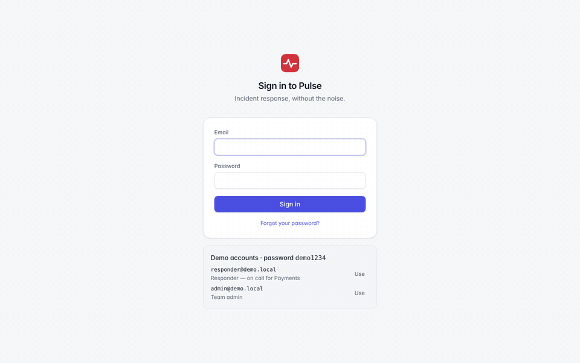
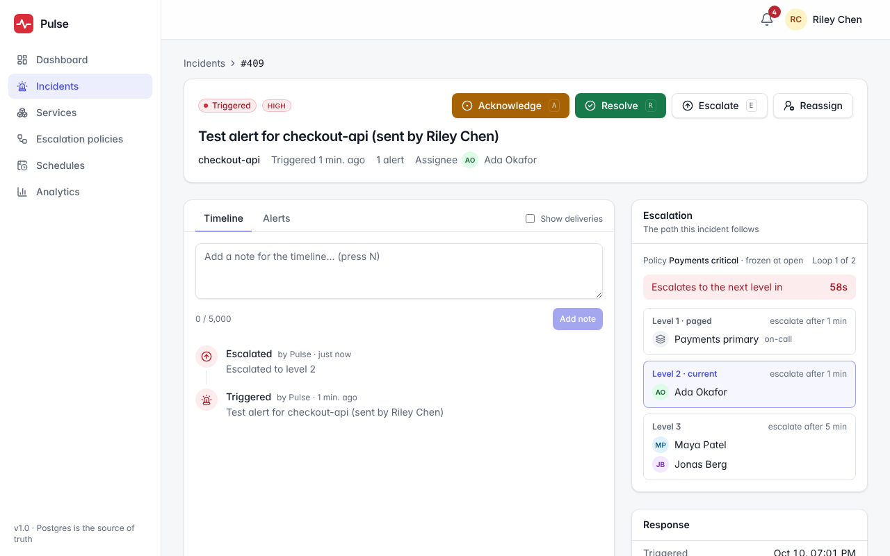
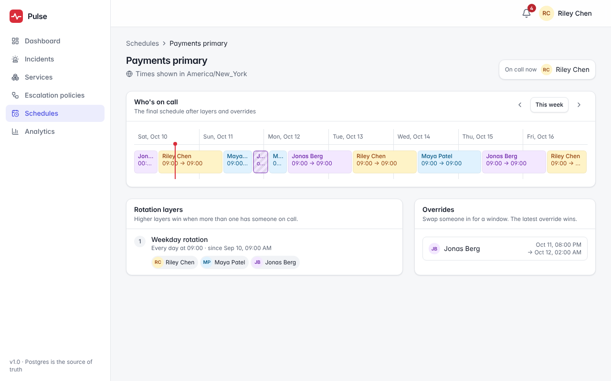
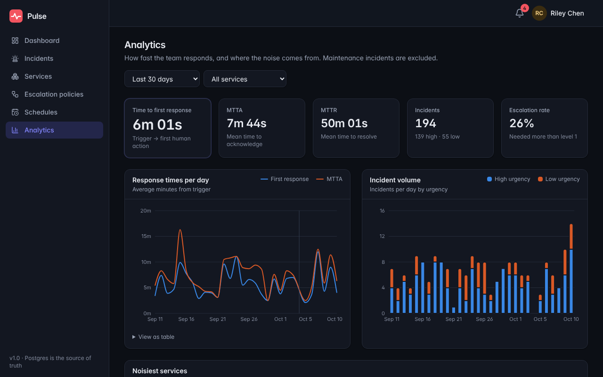
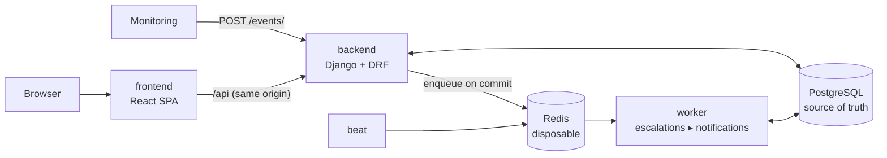

# Pulse

**Incident orchestration in the spirit of PagerDuty: alerts in, the right human paged exactly once, every action on the record.**

[](https://github.com/santheesh73/PagerDuty/actions/workflows/ci.yml)

[](LICENSE)



**Live demo:** not deployed yet. [`render.yaml`](render.yaml) deploys a free one-container demo as a Render Blueprint, reseeded daily ([limits and steps](docs/DEPLOY.md)).
**Demo logins** (seeded locally and on the demo): `responder@demo.local` / `demo1234` (on call for Payments), `admin@demo.local` / `demo1234` (team admin).

> **Tenancy: one organisation per deployment.** Teams inside it are isolated from each other on every endpoint, and a test walks every route to prove it. Separate customers are *not* isolated from each other: run one deployment per organisation. See [docs/TENANCY.md](docs/TENANCY.md).

## What this guarantees

Seventeen written guarantees, each with the mechanism that enforces it and the test that proves it, in [`docs/INVARIANTS.md`](docs/INVARIANTS.md). The ones that matter most:

- **An alert becomes exactly one incident**, however many arrive at once (I1).
- **A page is never sent twice, and never lost**: not on a duplicated task, a racing sweeper, a dead broker or a worker that dies mid-write (I4, I5).
- **Escalation always terminates and never stalls** (I6, I7).
- **A schedule names exactly one responder at any instant**, and handoffs stay at the configured local time across DST (I2, I11).
- **Maintenance never pages and debug never sends**, whatever a human clicks (I12, I13).
- **A page queued before an incident resolves never wakes anyone after** (C1).

**How it's proven:** Postgres constraints where a guarantee can be structural; property-based tests (Hypothesis) for the on-call maths; a seeded fault-injection simulator that checks the invariants after every operation under broker outages, lost and duplicated messages, workers dying mid-transaction, concurrent sweepers, clock skew and edits mid-flight; a k6 load run whose results are checked against the database; and one browser journey in CI. The simulator and the property tests each found real bugs, recorded with their fixes in [`docs/DECISIONS.md`](docs/DECISIONS.md). What is *not* mechanically checked is listed in INVARIANTS.md too.

## What makes this interesting

- **Restart-safe escalation timers.** The timer is a column in Postgres (`next_escalation_at`), not a Celery countdown. Wipe Redis mid-incident and it still escalates. [`make chaos-redis`](scripts/chaos_redis.sh) proves it live.
- **Race-free deduplication.** A partial unique index (`UNIQUE (service, dedup_key) WHERE status <> 'resolved'`) means eight identical alerts fired concurrently become one incident with eight alerts. No locks in Redis, no "find, else create" race.
- **Idempotent paging.** The ETA task and the safety-net sweeper are *designed* to race. A guarded `SELECT … FOR UPDATE SKIP LOCKED` lets exactly one win, and unique notification keys mean a retry can never page twice.
- **DST-correct rotations.** A 09:00 handoff stays at 09:00 local through spring-forward and fall-back (including a handoff inside the non-existent 02:30 hour). The resolver is pure functions with no database, tested exhaustively.
- **Policy snapshots.** Editing an escalation policy never rewires an incident already in flight, but schedule targets still follow the live rotation.
- **A frozen-time test suite.** 240 backend tests (93% coverage) drive the real timing model with explicit `now` and `time-machine`, plus threaded race tests. Celery never runs eagerly in engine tests.

## Quick start

Needs Docker. Everything else runs in containers.

```bash
git clone https://github.com/santheesh73/PagerDuty.git pulse && cd pulse
cp .env.example .env
make up          # builds and starts the stack, waits until every service is healthy, migrates, seeds
make check       # lint + typecheck + all tests + migration drift (what CI runs)
```

Open <http://localhost:5173> (sign in with the demo logins above). Pages are emailed to Mailpit at <http://localhost:8025>. API docs (Swagger UI): <http://localhost:8000/api/docs/>. Django admin: <http://localhost:8000/admin/>.

`make doctor` boots the production-like stack from scratch and proves it works end to end: an alert pages and escalates, a duplicate attaches, and Redis, the workers, the database and the API are each killed in turn and the stack recovers. It takes about 8 minutes and CI runs it on every push. Day-to-day: `make logs`, `make migrate`, `make seed`, `make db-backup`, `make down`; the [runbook](docs/RUNBOOK.md) has ports, environment variables and fixes for common failures.

<details>
<summary>Without Docker</summary>

Needs Python 3.13 with [uv](https://docs.astral.sh/uv/), Node 22, PostgreSQL 16+ and Redis 7.

```bash
psql -c "CREATE USER pulse WITH PASSWORD 'pulse' CREATEDB" && createdb -O pulse pulse
cp .env.example .env && set -a && . ./.env && set +a

cd backend && uv sync
uv run python manage.py migrate && uv run python manage.py seed_demo
uv run gunicorn config.wsgi -b :8000 &                       # API
uv run celery -A config worker -Q escalations,notifications,default &
uv run celery -A config beat &

cd ../frontend && npm ci && npm run dev                      # → http://localhost:5173
make check LOCAL=1                                           # quality gate on the host
```
</details>

## A two-minute guided demo

1. Sign in as **`responder@demo.local`** (password `demo1234`). The dashboard says *You're on call* for **Payments critical**.
2. Open **Services → checkout-api** and click **Send test alert**, or run `make send-alert` in a terminal. Click **Open incident** in the toast.
3. Watch the **Escalation** panel count down. The demo policy uses 1-minute delays, so about 60 seconds later the timeline shows **Escalated to level 2** and the page moves to Ada (the team admin).
4. Press <kbd>A</kbd> to **acknowledge**: the countdown stops.
5. Click **Unacknowledge**: the current level is paged again and its timer restarts.
6. Add a note, then press <kbd>R</kbd> to **resolve**. The timeline reads *triggered → escalated → acknowledged → unacknowledged → note → resolved*.
7. Open **Analytics**: time to first response, MTTA and MTTR over 60 days of seeded history, volume by urgency and the noisiest services.

Also try: **Schedules → Payments primary** (week timeline in the schedule's time zone, overrides), putting a service into **maintenance** (alerts fold into one quiet incident), or **debug** mode (pages are recorded as dry runs).

| Incident detail | Schedule | Analytics (dark) |
|---|---|---|
|  |  |  |

## Architecture



| Container | Role |
|---|---|
| `frontend` | React 19 + TypeScript SPA (Vite, React Router, TanStack Query, Tailwind) |
| `backend` | Django 6 + DRF API, Events API, admin; Gunicorn; `/healthz`, `/readyz` |
| `worker-escalations` | Celery worker that consumes **only** the `escalations` queue, so a notification backlog can never delay paging (`-Q` order alone is not a priority) |
| `worker` | Celery: `notifications` and `default` queues |
| `beat` | Escalation sweeper (30 s), mode expiry (60 s), stuck-notification sweeper (60 s) |
| `mailpit` | SMTP sink with an inbox UI at <http://localhost:8025>: every page is emailed here in dev; set `EMAIL_HOST` for real mail |
| `db` | PostgreSQL 17: dedup, single escalation and single page are all Postgres guarantees |
| `redis` | Broker + throttle cache, persistence deliberately off |

Read more: [**Architecture**](docs/ARCHITECTURE.md) (request flow, the timing model and the failures it survives, on-call algorithm, data model) · [**Decisions**](docs/DECISIONS.md) (18 numbered decisions with alternatives, plus what the property tests, the simulator and the runtime checks found) · [**Stack**](docs/STACK.md) (every pinned version and why).

## The seven capabilities

| | |
|---|---|
| **Services** | CRUD, team ownership, escalation policy, 32-byte integration key with rotation, `active` / `maintenance` / `debug` modes with expiry, *Send test alert* |
| **Alert ingestion** | Events API (`trigger` / `acknowledge` / `resolve`), severity → urgency, dedup and grouping by `dedup_key`, maintenance consolidation, 512 KB payload limit, per-key throttling |
| **Incidents** | One transition table incl. **unacknowledge**, assign/reassign, notes, manual escalate, full timeline, filters and search |
| **Escalation policies** | Ordered levels, per-level delay, user or schedule targets, 0–3 loops, policy snapshot frozen at open |
| **On-call schedules** | Daily / weekly / custom layers, local handoff time, IANA zone, layer priority, overrides, "who's on call now", rendered shift timeline |
| **Security** | TOTP MFA with backup codes (required for admins in production), password reset, per-account lockout, session list/revoke, append-only audit log, hashed integration keys with rotation grace, CSP and HSTS ([SECURITY_MODEL.md](docs/SECURITY_MODEL.md)). No SSO/OIDC |
| **Notifications** | In-app inbox, email, SMS and voice (Twilio, opt-in) and signed webhooks (Slack/Teams-compatible, SSRF-guarded); personal notification rules with delayed steps; signed one-time acknowledge/resolve links; retries, idempotency keys, dry-run in debug mode. SMS/voice are verified against a fake Twilio, **not a live carrier** ([CHANNELS.md](docs/CHANNELS.md)) |
| **Analytics** | **Time to first response** (headline), MTTA, MTTR, daily volume, noisiest services, escalation rate |

The API is versioned (`/api/v1/`), described by a committed OpenAPI schema, and answers every error with one JSON envelope. Lists page with a stable total order, filters are validated, and writes accept an `Idempotency-Key` for safe retries. Rate and size limits are documented. See [docs/API.md](docs/API.md).

## Measured

One run of `make loadtest` (k6 v2.3.0, Events API, 70% repeats of 50 hot dedup keys / 30% never-seen keys, 32 concurrent users for 60 s after a 5 s warm-up):

| | |
|---|---|
| Throughput | **77.3 requests/s** (4,635 requests in the measured minute) |
| Latency | p50 **411 ms** · p95 **532 ms** · p99 **593 ms** (max 700 ms) |
| Errors | 0 unexpected responses |
| After the run | 1,515 new keys → 1,515 incidents; 3,425 repeats → 3,425 alerts attached to the 50 hot incidents; no key with two open incidents; no notification left pending |

**Hardware and setup:** a 4 vCPU Intel Xeon @ 2.8 GHz VM with 15 GB RAM running *everything* on one host: k6, nginx, three gunicorn workers, the Celery worker, Beat, Postgres 17 and Redis. The per-key throttle (`THROTTLE_EVENTS`, default 120/min) was raised to 100,000/min so the run measures the ingest path, not the limiter. Closed-loop at saturation, so the latencies are queueing under load, not the cost of one request; treat the numbers as "what a small box does", not a benchmark. Run `make loadtest` (`VUS=`, `DURATION=` to change it) to get your own, and `loadtest/verify.py` fails the run if dedup ever broke.

## Testing

```bash
make test            # backend (pytest + coverage) and frontend (Vitest)
make check           # + ruff, mypy, eslint, tsc, prettier, migration drift
make chaos-redis     # live: wipe Redis mid-incident, confirm it still escalates
make simulate        # fault-injection simulator over seeds 1-20 (a failure prints its seed)
make loadtest        # k6 against the prod-like stack, then verify the database
make e2e             # Playwright: the alert→resolve journey, plus an axe audit of every main page
```

- **Property tests** (`schedules/tests/test_oncall_properties.py`): one responder at any instant, rendered shifts partition the window and agree with `on_call`, handoffs land on local time across DST in six zones, rotation fairness, determinism. They found a real fall-back bug.
- **Simulator** (`manage.py simulate --seed N`): real code, real Postgres, a virtual clock, injected faults, and `core/invariants.py` after every operation. The fixed seed runs in CI; any failure prints the seed and the command that reproduces it.

- **On-call resolver** (no DB): handoff instants, DST forward/back in New York and London, weekly/custom rotations, override precedence, layer priority, empty layers, shift rendering.
- **Escalation engine**: level advance, loops, exhaustion, ack stops it, ETA + sweeper double-fire pages once (plus a 4-thread race), no-responder skip, policy edits don't touch open incidents, unack restarts the timer, low urgency never escalates, debug → dry run, sweeper recovery after a lost ETA message, broker outage doesn't fail ingest.
- **Ingest**: dedup attach, an 8-thread race producing one incident, ack/resolve by key, unknown keys ignored, maintenance consolidation, mode expiry.
- **State machine**: every allowed and forbidden transition, exactly one timeline event per action, `first_response_at` set once and never by source events.
- **API**: permissions per role, validation and limits, cursor pagination, the error envelope, Events API auth and throttling (including failing open without Redis).
- **Frontend**: API client and CSRF, optimistic acknowledge and rollback on 409, keyboard shortcuts, the policy editor's payload and limits, the shift timeline including DST-length days.

Tests are named after behaviour (`test_ack_stops_escalation`, `test_policy_edit_does_not_change_open_incident`), so a regression fails a test that explains itself.

## Deploy

[docs/DEPLOY.md](docs/DEPLOY.md) has both paths, with their limits stated plainly.

- **A free demo:** one container ([`deploy/demo/Dockerfile`](deploy/demo/Dockerfile)) and a free Postgres, with no Redis and no Celery. Work due now runs in-process after commit, and timers are driven by a protected `POST /internal/tick/`. [`render.yaml`](render.yaml) is the Render Blueprint for it. CI boots it on every push and runs the whole alert flow through ticks alone (`make doctor-demo`).
- **A real deployment** on one Docker host: the full stack behind Caddy TLS ([`deploy/compose.production.yml`](deploy/compose.production.yml)), with scheduled backups. [`scripts/deploy.sh`](scripts/deploy.sh) builds a release, migrates, starts it, smoke-tests it with [`scripts/smoke.sh`](scripts/smoke.sh), and rolls back automatically if that fails. `--rollback` returns to the previous release without a rebuild.

Production settings refuse to start without `SECRET_KEY`, `ALLOWED_HOSTS` and `DATABASE_URL`. [`deploy/render-full.yaml`](deploy/render-full.yaml) deploys the full stack on Render; its workers have no free tier.

## Non-goals

Deliberately out of scope, so the core loop could go deep:

- automated workflows and runbooks;
- public status pages;
- browser push (SMS, voice and webhooks exist; see [CHANNELS.md](docs/CHANNELS.md));
- time-of-day restrictions on schedule layers;
- multi-org tenancy: one organisation per deployment, many teams ([why](docs/TENANCY.md));
- user-written routing or grouping rules.

## License

[MIT](LICENSE)
