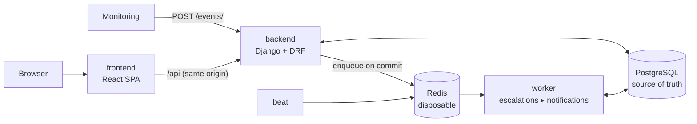

# Pulse

**Incident orchestration in the spirit of PagerDuty: alerts in, the right human paged exactly once, every action on the record.**

[](https://github.com/santheesh73/PagerDuty/actions/workflows/ci.yml)

[](LICENSE)


**Live demo:** not deployed yet. [`render.yaml`](render.yaml) deploys the whole stack as a Render Blueprint, re-seeded nightly ([deploy notes](#deploy)).
**Demo logins** (seeded locally and on the demo): `responder@demo.local` / `demo1234` (on call for Payments), `admin@demo.local` / `demo1234` (team admin).

## What makes this interesting

- **Restart-safe escalation timers.** The timer is a column in Postgres (`next_escalation_at`), not a Celery countdown. Wipe Redis mid-incident and it still escalates. [`make chaos-redis`](scripts/chaos_redis.sh) proves it live.
- **Race-free deduplication.** A partial unique index (`UNIQUE (service, dedup_key) WHERE status <> 'resolved'`) means eight identical alerts fired concurrently become one incident with eight alerts. No locks in Redis, no "find, else create" race.
- **Idempotent paging.** The ETA task and the safety-net sweeper are *designed* to race. A guarded `SELECT … FOR UPDATE SKIP LOCKED` lets exactly one win, and unique notification keys mean a retry can never page twice.
- **DST-correct rotations.** A 09:00 handoff stays at 09:00 local through spring-forward and fall-back (including a handoff inside the non-existent 02:30 hour). The resolver is pure functions with no database, tested exhaustively.
- **Policy snapshots.** Editing an escalation policy never rewires an incident already in flight, but schedule targets still follow the live rotation.
- **A frozen-time test suite.** 187 backend tests (94% coverage, 98% on the engines) drive the real timing model with explicit `now` and `time-machine`, plus threaded race tests. Celery never runs eagerly in engine tests.

## Quick start

Needs Docker. Everything else runs in containers.

```bash
git clone https://github.com/santheesh73/PagerDuty.git pulse && cd pulse
cp .env.example .env
make up          # builds and starts all six containers, migrates, seeds → http://localhost:5173
make check       # lint + typecheck + all tests + migration drift (what CI runs)
```

API docs (Swagger UI): <http://localhost:8000/api/docs/>. Django admin: <http://localhost:8000/admin/>.

<details>
<summary>Without Docker</summary>

Needs Python 3.13 with [uv](https://docs.astral.sh/uv/), Node 22, PostgreSQL 16+ and Redis 7.

```bash
psql -c "CREATE USER pulse WITH PASSWORD 'pulse' CREATEDB" && createdb -O pulse pulse
cp .env.example .env && set -a && . ./.env && set +a

cd backend && uv sync
uv run python manage.py migrate && uv run python manage.py seed_demo
uv run gunicorn config.wsgi -b :8000 &                       # API
uv run celery -A config worker -Q escalations,notifications,default &
uv run celery -A config beat &

cd ../frontend && npm ci && npm run dev                      # → http://localhost:5173
make check LOCAL=1                                           # quality gate on the host
```
</details>

## A two-minute guided demo

1. Sign in as **`responder@demo.local`** (password `demo1234`). The dashboard says *You're on call* for **Payments critical**.
2. Open **Services → checkout-api** and click **Send test alert**, or run `make send-alert` in a terminal. Click **Open incident** in the toast.
3. Watch the **Escalation** panel count down. The demo policy uses 1-minute delays, so about 60 seconds later the timeline shows **Escalated to level 2** and the page moves to Ada (the team admin).
4. Press <kbd>A</kbd> to **acknowledge**: the countdown stops.
5. Click **Unacknowledge**: the current level is paged again and its timer restarts.
6. Add a note, then press <kbd>R</kbd> to **resolve**. The timeline reads *triggered → escalated → acknowledged → unacknowledged → note → resolved*.
7. Open **Analytics**: time to first response, MTTA and MTTR over 60 days of seeded history, volume by urgency and the noisiest services.

Also try: **Schedules → Payments primary** (week timeline in the schedule's time zone, overrides), putting a service into **maintenance** (alerts fold into one quiet incident), or **debug** mode (pages are recorded as dry runs).

| Incident detail | Schedule | Analytics (dark) |
|---|---|---|
|  |  |  |

## Architecture



| Container | Role |
|---|---|
| `frontend` | React 19 + TypeScript SPA (Vite, React Router, TanStack Query, Tailwind) |
| `backend` | Django 6 + DRF API, Events API, admin; Gunicorn; `/healthz`, `/readyz` |
| `worker` | Celery: `escalations` queue first, so notifications can't delay paging |
| `beat` | Escalation sweeper (30 s), mode expiry (60 s), stuck-notification sweeper (5 min) |
| `db` | PostgreSQL 17: dedup, single escalation and single page are all Postgres guarantees |
| `redis` | Broker + throttle cache, persistence deliberately off |

Read more: [**Architecture**](docs/ARCHITECTURE.md) (request flow, the timing model and the failures it survives, on-call algorithm, data model) · [**Decisions**](docs/DECISIONS.md) (17 entries, with alternatives) · [**Stack**](docs/STACK.md) (every pinned version and why).

## The seven capabilities

| | |
|---|---|
| **Services** | CRUD, team ownership, escalation policy, 32-byte integration key with rotation, `active` / `maintenance` / `debug` modes with expiry, *Send test alert* |
| **Alert ingestion** | Events API (`trigger` / `acknowledge` / `resolve`), severity → urgency, dedup and grouping by `dedup_key`, maintenance consolidation, 512 KB payload limit, per-key throttling |
| **Incidents** | One transition table incl. **unacknowledge**, assign/reassign, notes, manual escalate, full timeline, filters and search |
| **Escalation policies** | Ordered levels, per-level delay, user or schedule targets, 0–3 loops, policy snapshot frozen at open |
| **On-call schedules** | Daily / weekly / custom layers, local handoff time, IANA zone, layer priority, overrides, "who's on call now", rendered shift timeline |
| **Notifications** | In-app inbox + email behind a `Channel` protocol, retries with backoff, idempotency keys, dry-run in debug mode |
| **Analytics** | **Time to first response** (headline), MTTA, MTTR, daily volume, noisiest services, escalation rate |

## Testing

```bash
make test            # backend (pytest + coverage) and frontend (Vitest)
make check           # + ruff, mypy, eslint, tsc, prettier, migration drift
make chaos-redis     # live: wipe Redis mid-incident, confirm it still escalates
```

- **On-call resolver** (no DB): handoff instants, DST forward/back in New York and London, weekly/custom rotations, override precedence, layer priority, empty layers, shift rendering.
- **Escalation engine**: level advance, loops, exhaustion, ack stops it, ETA + sweeper double-fire pages once (plus a 4-thread race), no-responder skip, policy edits don't touch open incidents, unack restarts the timer, low urgency never escalates, debug → dry run, sweeper recovery after a lost ETA message, broker outage doesn't fail ingest.
- **Ingest**: dedup attach, an 8-thread race producing one incident, ack/resolve by key, unknown keys ignored, maintenance consolidation, mode expiry.
- **State machine**: every allowed and forbidden transition, exactly one timeline event per action, `first_response_at` set once and never by source events.
- **API**: permissions per role, validation and limits, cursor pagination, the error envelope, Events API auth and throttling (including failing open without Redis).
- **Frontend**: API client and CSRF, optimistic acknowledge and rollback on 409, keyboard shortcuts, the policy editor's payload and limits, the shift timeline including DST-length days.

Tests are named after behaviour (`test_ack_stops_escalation`, `test_policy_edit_does_not_change_open_incident`), so a regression fails a test that explains itself.

## Deploy

[`render.yaml`](render.yaml) is a Render Blueprint for the whole stack: managed Postgres 17 and Key Value (Redis), the API, worker, beat, the nginx-served SPA and a nightly `seed_demo --reset` cron job. In Render: **New → Blueprint → this repo**. Workers and cron jobs have no free tier on Render (≈ $7/month each on Starter).

[`docker-compose.prod.yml`](docker-compose.prod.yml) runs the same production images on any Docker host: `SECRET_KEY=$(openssl rand -hex 32) docker compose -f docker-compose.prod.yml up --build -d` → <http://localhost:8080>. Production settings refuse to start without `SECRET_KEY`, `ALLOWED_HOSTS` and `DATABASE_URL`.

## Non-goals

Deliberately out of scope, so the core loop could go deep:

- automated workflows and runbooks;
- public status pages;
- SMS, phone and push (the `Channel` protocol makes each a one-class addition);
- time-of-day restrictions on schedule layers;
- multi-org tenancy (one org, many teams);
- user-written routing or grouping rules;
- personal notification rules (every page goes to in-app + email).

## License

[MIT](LICENSE)
