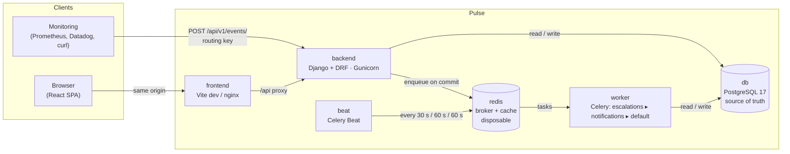
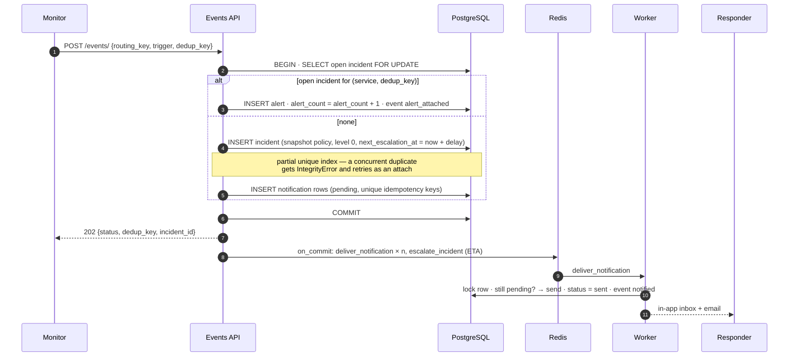
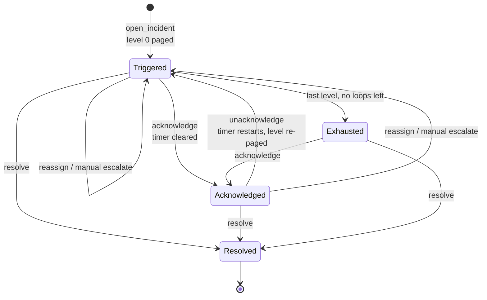

# Architecture

Pulse is a Django + DRF API, a Celery worker and Beat scheduler, a React SPA, PostgreSQL and
Redis. **PostgreSQL is the only source of truth.** Redis is a broker and cache that can be
wiped at any moment without losing or stalling an incident.

## Containers



| Container | Role |
|---|---|
| `frontend` | React SPA. Vite dev server in development; nginx serving the built bundle in production. Proxies `/api` so the browser sees one origin (cookies + CSRF, no CORS). |
| `backend` | Django + DRF API, Events API, admin. Gunicorn. `/healthz` (process up) and `/readyz` (DB + Redis reachable). |
| `worker-escalations` | A Celery worker that consumes **only** the `escalations` queue. Listing queues in `-Q` order is not a priority (kombu's Redis transport round-robins its queues), so isolation needs a separate worker; a notification backlog (slow SMTP, retries) can then never delay paging. |
| `worker` | Celery worker for `notifications` and `default`. Without `CELERY_QUEUES` one process serves all three queues (used on single-worker hosts such as the Render demo). |
| `beat` | `sweep_due_escalations` every 30 s, `expire_service_modes` every 60 s, `sweep_stuck_notifications` every 60 s. |
| `mailpit` | Dev and smoke-test SMTP sink with an inbox UI; production points `EMAIL_HOST` at a real server. |
| `db` | PostgreSQL 17. Every guarantee (dedup, single escalation, single page) is a Postgres constraint or row lock. |
| `redis` | Broker + throttle cache. Started with persistence off on purpose. |

## Backend layering

The same pattern in every app, so a reader always knows where to look:

| Module | Responsibility |
|---|---|
| `views.py` | Parse input, check permissions, call one action or selector, serialize. No business logic. |
| `actions.py` | All writes: transactions, row locks, timeline events, `transaction.on_commit` dispatch. |
| `selectors.py` | All reads and aggregates. |
| `tasks.py` | Thin Celery wrappers that call actions or engines. |
| `engine.py` / `oncall.py` | Pure domain logic (`oncall.py` touches no database at all). |

Errors are domain exceptions (`InvalidTransition`, `LimitExceeded`, `Conflict`) mapped to one
envelope in a single place: `{"error": {"code", "message", "details"}}`, with 409 for state
conflicts and 422 for validation and limits.

## Request flow: an alert becomes a page



## The escalation timing model



(*Exhausted* is a triggered incident with no timer: it stays open and visible but pages no
one further.)

**The database is the timer.** `next_escalation_at` records when the current level expires.
Two callers try to move the incident on:

1. **ETA task**, enqueued after commit for exactly `next_escalation_at`. It gives low latency
   in the normal case.
2. **Beat sweeper**, every 30 s, which selects `status = triggered AND next_escalation_at <=
   now`. It is the safety net.

Both call `engine.escalate(incident_id, level, loop, now)`:

```python
inc = (Incident.objects.select_for_update(skip_locked=True)
       .filter(pk=incident_id, status=TRIGGERED, escalation_level=level,
               escalation_loop=loop, next_escalation_at__lte=now).first())
if inc is None:
    return False   # acked, resolved, already escalated, or another worker holds the lock
```

Only a caller that observes *exactly* the state it expects can act, and only one can hold the
row lock. Combined with unique notification keys, that makes escalation idempotent.

### Failure modes it survives

| Failure | What happens |
|---|---|
| Redis restarts, losing every queued message | The sweeper finds the overdue incident in Postgres within 30 s and escalates it. Pending notification rows are re-dispatched by `sweep_stuck_notifications`. Verified live by `make chaos-redis`. |
| Broker is down when the API tries to enqueue | `dispatch.on_commit` logs and moves on, so the API request still succeeds. The intent is already committed. |
| Worker dies mid-task | `acks_late` + `reject_on_worker_lost` re-deliver the message; the guarded query makes the retry safe. |
| ETA task and sweeper fire at the same moment | One wins the guarded row lock; the other matches nothing. Test: `test_eta_task_and_sweeper_double_fire_pages_once`. |
| Two identical alerts arrive together | The partial unique index rejects the second insert; it retries as an attach. Test: 8 concurrent threads, one incident. |
| Email provider flaps | Delivery retries with exponential backoff up to 5 attempts, then the row is `failed` and the timeline shows `notification_failed`. |
| A policy is edited during an incident | The incident follows the snapshot it took at open time. |
| Nobody is on call at a level | `no_responder` is logged and the incident is due immediately, so the next sweep moves on. |
| Throttle cache (Redis) is down | Throttles fail open; ingest keeps working. |

## On-call resolution

`apps/schedules/oncall.py` is pure functions over frozen dataclasses (`LayerSpec`,
`OverrideSpec`, `ScheduleSpec`). Selectors load them; the API, the shift timeline and the
escalation engine all call the same functions.

```text
on_call(schedule, at):
    1. overrides covering `at` (start <= at < end)  → latest created wins
    2. otherwise each layer, highest priority first → first layer with someone on call
    3. otherwise nobody

layer_user_at(layer, at):
    custom rotation      turns = (at - start) // turn_length              # absolute hours
    daily / weekly       turns = (shift_day(at) - shift_day(start)).days // days_per_turn
                         shift_day = local date, or the day before if local time < handoff
    → members[turns % len(members)]
```

`render_shifts(schedule, since, until)` collects every instant where the answer *could*
change (layer starts, handoffs, override edges), evaluates `on_call` once per segment and
merges equal neighbours, which is exact by construction. A handoff that falls inside a DST
gap (e.g. 02:30 on the spring-forward day in New York) is placed at the first real instant
whose local time is at or after the handoff, found by binary search. The frontend lays the
week out on the schedule's own local midnights, so a DST day really is drawn 23 or 25 hours
wide.

## Data model

```mermaid
erDiagram
    TEAM ||--o{ MEMBERSHIP : has
    USER ||--o{ MEMBERSHIP : has
    TEAM ||--o{ SERVICE : owns
    TEAM ||--o{ ESCALATION_POLICY : owns
    TEAM ||--o{ SCHEDULE : owns
    ESCALATION_POLICY ||--o{ ESCALATION_RULE : "levels"
    ESCALATION_RULE ||--o{ ESCALATION_TARGET : "who to page"
    ESCALATION_TARGET }o--|| USER : "user or"
    ESCALATION_TARGET }o--|| SCHEDULE : "schedule"
    SERVICE }o--|| ESCALATION_POLICY : uses
    SCHEDULE ||--o{ SCHEDULE_LAYER : has
    SCHEDULE_LAYER ||--o{ LAYER_MEMBER : rotates
    SCHEDULE ||--o{ SCHEDULE_OVERRIDE : has
    SERVICE ||--o{ INCIDENT : raises
    SERVICE ||--o{ ALERT : receives
    INCIDENT ||--o{ ALERT : groups
    INCIDENT ||--o{ INCIDENT_EVENT : timeline
    INCIDENT ||--o{ NOTIFICATION : pages

    INCIDENT {
        bigint number "sequence"
        string status "triggered | acknowledged | resolved"
        string dedup_key "UNIQUE(service, dedup_key) WHERE status <> resolved"
        json escalation_snapshot "frozen at open"
        int escalation_level
        int escalation_loop
        timestamptz next_escalation_at "the timer"
        timestamptz first_response_at
    }
    NOTIFICATION {
        string idempotency_key "UNIQUE"
        string status "pending | sent | failed | dry_run | cancelled"
        int attempts
    }
    ESCALATION_TARGET {
        fk target_user "CHECK exactly one"
        fk target_schedule "CHECK exactly one"
    }
```

Indexes that matter: `(status, next_escalation_at)` for the sweeper, `(service,
triggered_at)` for analytics, `(incident, created_at)` for timelines, `(user, read_at)` for
the inbox, and partial indexes on pending notifications and expiring service modes.

## Observability

- Structured JSON logs (`python-json-logger`) with a request ID on every line.
- `X-Request-ID` is accepted from the caller if well-formed, otherwise generated. It is
  returned on the response, carried into Celery task headers, and restored in the worker, so
  one ID follows an alert from the Events API call through every task it triggers.
- Task failures log the incident ID. Health: `/healthz` (process) and `/readyz` (DB + Redis).
